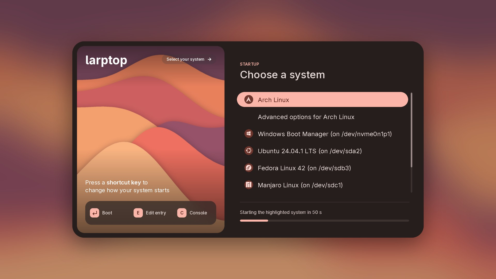
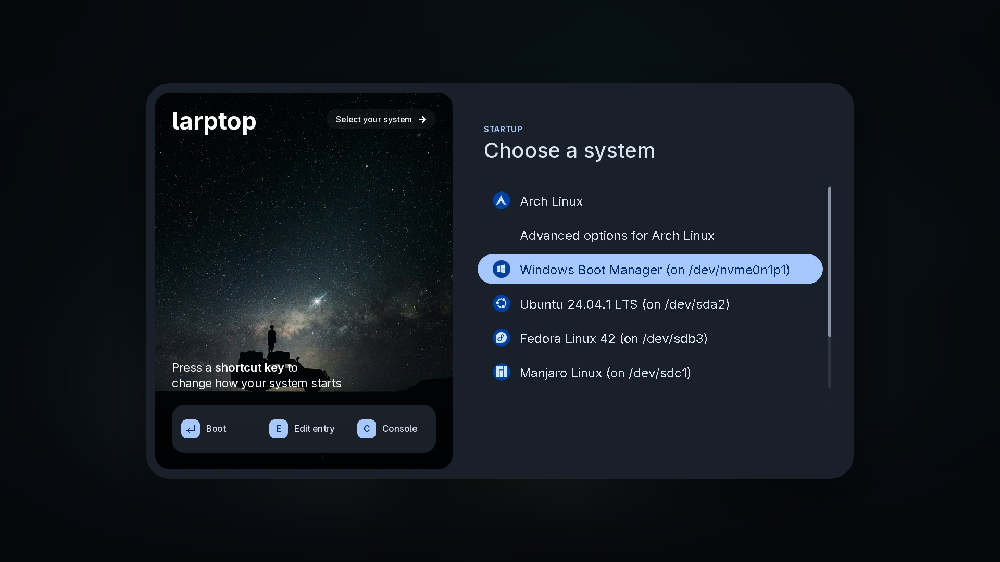
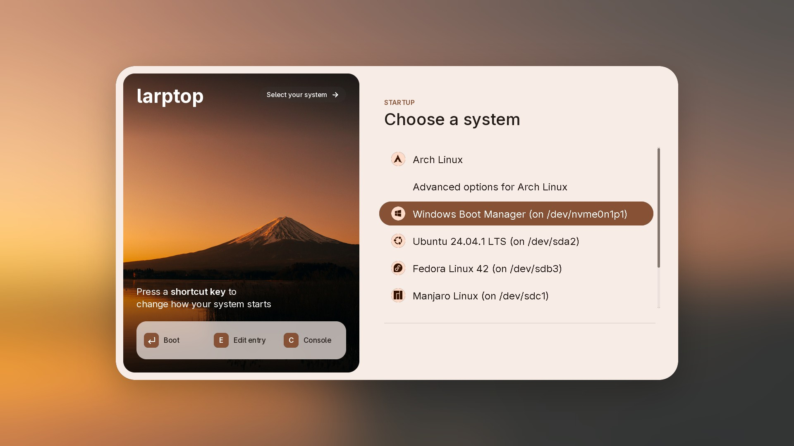

# Pixel You — a Material You GRUB theme

A Pixel-style GRUB theme with a windowed layout. Its colours come from your wallpaper the same way Material You picks them. The wallpaper fills the left panel and shows blurred behind the window. The boot menu sits on the right as a Material 3 navigation drawer. The countdown is a thin linear progress indicator.





*(The screenshots were taken from GRUB 2.16 running in QEMU/OVMF.)*

## Install

```bash
sudo ./install.sh -w ~/Pictures/Wallpapers/my-wallpaper.jpg
```

Run it again whenever you change wallpaper. The theme is regenerated and installed, and `grub.cfg` is rebuilt.

| option | meaning |
|---|---|
| `-w FILE` | wallpaper (default: `wallpapers/waves.png`) |
| `-r WxH` | resolution (default: native mode of the connected display) |
| `-m dark\|light\|auto` | colour mode (default `dark`; `auto` follows wallpaper brightness) |
| `-s tonal-spot\|vibrant\|neutral` | Material scheme (default `tonal-spot`, Pixel's default) |
| `-c '#rrggbb'` | seed colour instead of extracting one |
| `-t TEXT` | wordmark on the wallpaper panel (default: hostname) |
| `-z ZOOM` | magnify the content inside the window: `1.0` default, `1.2` = 20% bigger, `0.8` = smaller (range 0.5–1.33). The window keeps its size. Higher zoom shows fewer entries at once (3 at 1.33) and clips long titles sooner. |
| `--no-os-prober` | leave os-prober settings alone |
| `--uninstall` | remove the theme and rebuild `grub.cfg` |

Changes the installer makes to `/etc/default/grub` (the first run saves a backup to `/etc/default/grub.pixel-you.bak`):

- `GRUB_THEME` points to `/boot/grub[2]/themes/pixel-you/theme.txt`
- `GRUB_GFXMODE="WxH,auto"`
- `GRUB_DISABLE_OS_PROBER="false"`
- `GRUB_TERMINAL_OUTPUT=console`, if set, is commented out because themes need gfxterm

It runs `update-grub`, `grub-mkconfig` or `grub2-mkconfig`, whichever exists. That works on Arch, Debian/Ubuntu and Fedora/openSUSE.

## Preview without rebooting

```bash
python3 generate.py my-wallpaper.jpg -o build/pixel-you --preview build/preview.png
```

To see it in real GRUB (needs `qemu` and OVMF):

```bash
tools/qemu-preview.sh build/pixel-you build/grub.png 1920x1080
```

`build/pixel-you/palette.json` lists the generated Material roles (`primary`, `surface_container`, …).

## os-prober compatibility

GRUB 2.06 and later turn os-prober off by default, so the installer turns it back on. Make sure the `os-prober` package is installed. Every OS that os-prober finds gets an icon:

- `30_os-prober` tags each entry with `--class <first word of the OS label>`. Examples: `windows`, `ubuntu`, `fedora`, `manjarolinux`, `linuxmint`, `opensuse`, `pop`, `endeavouros`, `macosx`, … It then adds `gnu-linux` / `os` as fallbacks.
- `10_linux` uses your `GRUB_DISTRIBUTOR` (e.g. `arch`).
- The theme ships 78 class icons, distro aliases included. Each one is a tonal badge in your palette. GRUB tries the classes in order, so an unknown Linux still gets Tux via `gnu-linux`/`os`.

The logos come from a [Nerd Font](https://www.nerdfonts.com/) if one is installed. Without one, the badges show the first letter of the class.

## Notes and limits

- **Resolution:** generate the theme on the machine that will boot it, so it matches that screen. All positions are proportional, so the layout still lines up if GRUB runs at a different mode. Text and icons keep their pixel size, though, so on a bigger screen they look smaller and on a smaller one bigger. To check what GRUB really uses, press `c` at the boot menu and run `videoinfo`; the current mode is marked with `*`. Then reinstall with `-r WxH` if it differs. Detection uses the kernel's mode list and falls back to the monitor's EDID. With several monitors it uses the first one and prints a note.
- **Fonts:** Google Sans is used if installed, then Inter, Adwaita Sans, Roboto, Noto Sans and DejaVu. Use `--font` to pick one. GRUB draws text without anti-aliasing, so menu text looks crisper and harder-edged than the text baked into the background.
- **Colours** approximate Material's HCT: OKLCH hue and chroma, solved to the exact CIELAB L\* tone. Contrast follows Material's tone ladder, but hues can differ slightly from Android's.
- Entries such as *UEFI Firmware Settings* and *Advanced options* have no `--class`, so they get no icon.
- Requires `python3`, Pillow and `grub-mkfont`.
